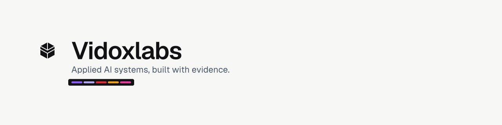

<picture>
  <source media="(prefers-color-scheme: dark)" srcset="vidoxlabs-banner-dark.svg">
  
</picture>

Applied AI systems, built with evidence.

# Vidoxlabs

We build agent frameworks. Each part is its own small repository: the harness floor, context retrieval, memory, planning and review, tooling, testing, and the workspace that puts them together. videsign is the design system the family wears.

Earlier Vidoxlabs engineering lived behind gates. This generation opens the lessons instead. Consent-gated memory, structural forgetting, fail-closed checks, deterministic validation: contract code with passing tests, not marketing copy. Every repository says exactly what it ships, and when a capability is specified rather than shipped, the repo says that.

## Start here

1. **[Bloom](https://github.com/Vidoxlabs/bloom)** — the team workspace. Give a head agent a brief and follow the work from brief to artifact.
2. **[Docs](https://github.com/Vidoxlabs/docs)** — the documentation hub. Pages are written there, and every public repository's documentation is synced in verbatim.
3. **[videsign](https://github.com/Vidoxlabs/videsign)** — the shared design system: tokens, components, and an MCP server.

Products take ordinary botanical words, named for what they do; the full [naming law](https://github.com/Vidoxlabs/capillary/blob/main/docs/family.md) spells it out. Health is observed, not claimed: trellis runs [dated verification](https://github.com/Vidoxlabs/trellis/blob/main/docs/evidence/family-grid-2026-11-22.md) over the whole family and keeps the receipts.

## The agent family

Each banner below follows the visitor's colour scheme. Click the name to open the repository.

### Workspace

<picture>
  <source media="(prefers-color-scheme: dark)" srcset="https://raw.githubusercontent.com/Vidoxlabs/bloom/main/.github/assets/bloom-banner-dark.png">
  
</picture>

[**Bloom**](https://github.com/Vidoxlabs/bloom) — The agent workspace: create a head agent, share a desktop, follow the work from brief to artifact.

### Foundation

<picture>
  <source media="(prefers-color-scheme: dark)" srcset="https://raw.githubusercontent.com/Vidoxlabs/seed/main/.github/assets/seed-banner-dark.png">
  
</picture>

[**Seed**](https://github.com/Vidoxlabs/seed) — Harness foundation for agent workspaces: run contracts, tool identity, provider adapters.

### Context and memory

<picture>
  <source media="(prefers-color-scheme: dark)" srcset="https://raw.githubusercontent.com/Vidoxlabs/capillary/main/.github/assets/capillary-banner-dark.png">
  
</picture>

[**Capillary**](https://github.com/Vidoxlabs/capillary) — Context retrieval and relations for agent workspaces: provenance-honest sources, bounded packets.

<picture>
  <source media="(prefers-color-scheme: dark)" srcset="https://raw.githubusercontent.com/Vidoxlabs/myosotis/main/.github/assets/myosotis-banner-dark.png">
  
</picture>

[**Myosotis**](https://github.com/Vidoxlabs/myosotis) — Governed memory for agents: consent to keep, structural forget.

### Plans and tools

<picture>
  <source media="(prefers-color-scheme: dark)" srcset="https://raw.githubusercontent.com/Vidoxlabs/aestivation/main/.github/assets/aestivation-banner-dark.png">
  
</picture>

[**Aestivation**](https://github.com/Vidoxlabs/aestivation) — Admission and review for agent work: plan validation, verdicts, the assembly gate.

<picture>
  <source media="(prefers-color-scheme: dark)" srcset="https://raw.githubusercontent.com/Vidoxlabs/drosera/main/.github/assets/drosera-banner-dark.png">
  
</picture>

[**Drosera**](https://github.com/Vidoxlabs/drosera) — Tooling for agents: tool faces, skills, hooks, cookbooks.

### Testing and documentation

<picture>
  <source media="(prefers-color-scheme: dark)" srcset="https://raw.githubusercontent.com/Vidoxlabs/trellis/main/.github/assets/trellis-banner-dark.png">
  
</picture>

[**Trellis**](https://github.com/Vidoxlabs/trellis) — Multi-point testing for the agent family: shape, behavior, consistency, operational.

<picture>
  <source media="(prefers-color-scheme: dark)" srcset="https://raw.githubusercontent.com/Vidoxlabs/docs/main/.github/assets/docs-banner-dark.png">
  
</picture>

[**Docs**](https://github.com/Vidoxlabs/docs) — Documentation for the Vidoxlabs agent family: written here, synced from every public repository.

## Design

<picture>
  <source media="(prefers-color-scheme: dark)" srcset="https://raw.githubusercontent.com/Vidoxlabs/videsign/main/brand/brand_lockup_horizontal-dark_v004.svg">
  
</picture>

[`videsign`](https://github.com/Vidoxlabs/videsign) is the shared design system: tokens, components, and an MCP server. Family README banners and the org banner follow its brand fields and signature colours. The next version of [vidoxlabs.dev](https://vidoxlabs.dev) is being rebuilt on it.

## The engineering law

- MIT on the agent family repositories, zero runtime dependencies, Node >= 22.13. `npm test` must pass; the built-in runner is enough. videsign states its own terms in its license file.
- Claim labels stay true. `implemented` means a passing test by that name; `specified` means the contract exists, not that it ships.
- Fail closed everywhere, including in the tests that check the products.
- No secrets, hostnames, or network detail in public files.
- Deterministic checks outrank judgment, and what an owner must ratify, an owner ratifies.

## Public repositories

The catalog below is refreshed automatically. The banners and short descriptions above are the readable map; this table is the full public list, including this profile repository.

<!-- BEGIN REPO TABLE -->
| Repository | Description | Language | Stars |
|---|---|---|---|
| [.github](https://github.com/Vidoxlabs/.github) | Vidoxlabs org profile: the agentic frameworks family, its shared engineering law, and org-wide contributor, security, and issue tooling. | - | 0 |
| [aestivation](https://github.com/Vidoxlabs/aestivation) | Admission and review for agent work: plan validation, verdicts, the assembly gate. | JavaScript | 0 |
| [bloom](https://github.com/Vidoxlabs/bloom) | The agent workspace: create a head agent, share a desktop, follow the work from brief to artifact. | JavaScript | 0 |
| [capillary](https://github.com/Vidoxlabs/capillary) | Context retrieval and relations for agent workspaces: provenance-honest sources, bounded packets. | JavaScript | 0 |
| [docs](https://github.com/Vidoxlabs/docs) | Documentation for the Vidoxlabs agent family: written here, synced from every public repository. | JavaScript | 0 |
| [drosera](https://github.com/Vidoxlabs/drosera) | Tooling for agents: tool faces, skills, hooks, cookbooks. | JavaScript | 0 |
| [myosotis](https://github.com/Vidoxlabs/myosotis) | Governed memory for agents: consent to keep, structural forget. | JavaScript | 0 |
| [seed](https://github.com/Vidoxlabs/seed) | Harness foundation for agent workspaces: run contracts, tool identity, provider adapters. | JavaScript | 0 |
| [trellis](https://github.com/Vidoxlabs/trellis) | Multi-point testing for the agent family: shape, behavior, consistency, operational. | JavaScript | 0 |
| [videsign](https://github.com/Vidoxlabs/videsign) | Component library for stylistic consistency and modular placement across developments. | JavaScript | 0 |
<!-- END REPO TABLE -->

_Auto-synced weekly (see the [sync workflow](https://github.com/Vidoxlabs/.github/blob/main/.github/workflows/sync-repo-table.yml))._

## Contributing and license

- [Contributing guide](https://github.com/Vidoxlabs/.github/blob/main/CONTRIBUTING.md)
- [Security policy](https://github.com/Vidoxlabs/.github/blob/main/SECURITY.md)
- The agent family repositories (`seed`, `bloom`, `capillary`, `myosotis`, `aestivation`, `drosera`, `trellis`, and `docs`) are [MIT](https://github.com/Vidoxlabs/seed/blob/main/LICENSE). Each repository carries its own license file. videsign states its own terms.

## Connect

- **Website:** [vidoxlabs.dev](https://vidoxlabs.dev)
- **Email:** admin@vidoxlabs.dev
- **Location:** United States

---

Vidoxlabs LLC — agent frameworks, built with evidence.
