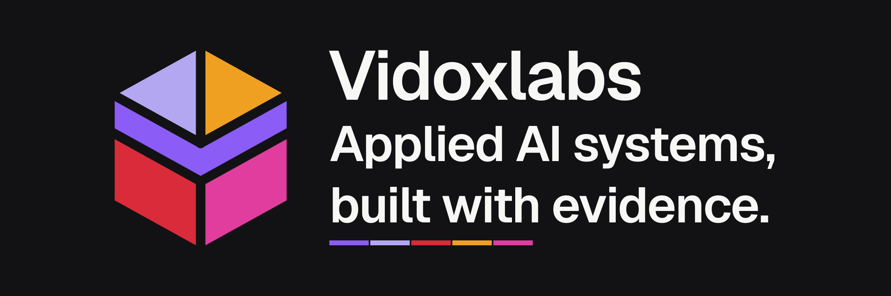

# Vidoxlabs

Vidoxlabs builds **agentic frameworks** — a family of small, honest, dependency-free components that make AI agents runnable, feedable, memorable, accountable, and testable — together with the design system that keeps everything we ship looking like it belongs together.

Earlier Vidoxlabs engineering lived mostly behind gates: private systems, internal tooling, gated infrastructure. That generation built real things and taught hard lessons — consent-gated memory, structural forgetting, fail-closed checks, deterministic validation — and those lessons are now open. Today the trajectory is public-first: every component in the table below is a working, tested repository you can read, run, and build on, and the systems we run ourselves are being re-engineered onto this same foundation.

Nothing here is vaporware and nothing overclaims. Each repository carries its own honest status; when a capability is specified rather than shipped, the repo says so.

---

## The agent family

The public products take ordinary botanical words, named for what each system does — one design law across the line:

| Name | Province |
|---|---|
| [`seed`](https://github.com/Vidoxlabs/seed) | The agent harness foundation: run contracts, neutral tool identity, provider adapters |
| [`capillary`](https://github.com/Vidoxlabs/capillary) | Context retrieval and relations: provenance-honest sources, bounded packets |
| [`myosotis`](https://github.com/Vidoxlabs/myosotis) | Governed memory: consent to keep, structural forget — the flower is a forget-me-not |
| [`aestivation`](https://github.com/Vidoxlabs/aestivation) | Admission and review: plan proposals, deterministic rule packs, verdicts, the assembly gate |
| [`drosera`](https://github.com/Vidoxlabs/drosera) | The tooling fabric: tool faces, skills, hooks, cookbooks |
| [`trellis`](https://github.com/Vidoxlabs/trellis) | The testing lattice: multi-point probes — shape, behavior, consistency, operational |
| [`bloom`](https://github.com/Vidoxlabs/bloom) | The team workspace harness the family serves: agent teams, shared desktop, shipped artifacts |

Family governance lives in each repository's own contracts and in [the naming law](https://github.com/Vidoxlabs/capillary/blob/main/docs/family.md). Health is not claimed; it is observed — [`trellis`](https://github.com/Vidoxlabs/trellis) runs dated, multi-point verification over the family and [keeps the receipts](https://github.com/Vidoxlabs/trellis/blob/main/docs/evidence/family-grid-2026-11-22.md).

### videsign

[`videsign`](https://github.com/Vidoxlabs/videsign) is the shared design system and component library — visual language, semantic tokens, and an MCP server so agents and humans build with the same design canon. The next generation of [vidoxlabs.dev](https://vidoxlabs.dev) is being rebuilt on it.

---

## The engineering law

Every public repository in this org holds the same discipline:

- **MIT licensed, zero runtime dependencies, Node >= 22.13.** `npm test` runs the built-in runner and must stay green — a claim of `implemented` requires a passing test named for it.
- **Honest claim labels.** Capabilities carry labels — `implemented`, `specified`, `planned`, `observed` — and the label must be true on its face. A contract that ships without code is labeled `specified`, not marketed as done.
- **Fail closed, in the products and in their tests.** Hooks fail closed, gates hold, unknown stays unknown, forgotten means forgotten. Probes that check these rules fail closed too.
- **Public means public.** No secrets, internal hostnames, network topologies, or credentials in any public file, ever.
- **Determinism as doctrine.** Validation is deterministic first and judgment second, and neither borrows the other's job. What an owner must ratify, an owner ratifies.

---

## Public repositories

<!-- BEGIN REPO TABLE -->
| Repository | Description | Language | Stars |
|---|---|---|---|
| [.github](https://github.com/Vidoxlabs/.github) | Vidoxlabs public landing page. Dedicated to Artificial Intelligence development, autonomous systems, and advanced LLM orchestration. | - | 0 |
| [aestivation](https://github.com/Vidoxlabs/aestivation) | Plan proposal, deterministic validation, review verdicts, and the assembly gate. The admission and review loop in the bloom agent family. | JavaScript | 0 |
| [bloom](https://github.com/Vidoxlabs/bloom) | A local-first, model-agnostic workspace for agent teams. Create a head agent, share a desktop, and follow the work from brief to artifact. | JavaScript | 0 |
| [capillary](https://github.com/Vidoxlabs/capillary) | A local-first context retrieval system: provenance-honest sources, bounded packets, and context relations for agent workspaces like Bloom | JavaScript | 0 |
| [drosera](https://github.com/Vidoxlabs/drosera) | The tooling fabric: tool faces, skills, hooks, and cookbooks. The extensions an agent works with, in the bloom agent family. | JavaScript | 0 |
| [myosotis](https://github.com/Vidoxlabs/myosotis) | A governed memory fabric: consent to keep, promise to forget. The memory successor in the bloom agent family. | JavaScript | 0 |
| [seed](https://github.com/Vidoxlabs/seed) | A local-first agent harness foundation: run contracts, tool identity, and provider adapters that work with Bloom | JavaScript | 0 |
| [trellis](https://github.com/Vidoxlabs/trellis) | The testing lattice: multi-point probes that keep the bloom agent family honest — shape, behavior, consistency, operational. | JavaScript | 0 |
| [videsign](https://github.com/Vidoxlabs/videsign) | videsign is Vidoxlabs’ JavaScript-based design system and component library, providing reusable UI primitives, visual language standards, preview components, and an MCP server to support consistent theming and interface development across the sovereign AI agent ecosystem. | JavaScript | 0 |
<!-- END REPO TABLE -->

_Auto-synced weekly via CI — see [sync workflow](https://github.com/Vidoxlabs/.github/blob/main/.github/workflows/sync-repo-table.yml)._

---

## Connect

- **Website:** [vidoxlabs.dev](https://vidoxlabs.dev)
- **Email:** admin@vidoxlabs.dev
- **Location:** United States

---

Vidoxlabs LLC — agentic frameworks, deterministic engineering, local-first compute.
